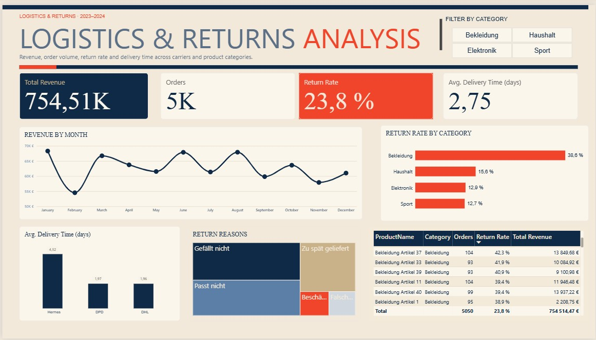

# E-Commerce Logistics & Returns Analysis

An end-to-end Business Intelligence project analyzing e-commerce logistics, delivery performance, product returns, and data quality using **Python, SQL, SQLite, and Power BI**.

## Dashboard Preview



## Overview

This project simulates a German e-commerce business and explores how delivery performance, logistics providers, and product categories relate to customer returns.

It covers the full data workflow, from synthetic data generation and validation to database design and SQL-based business analysis.

**Note:** The dataset is synthetic and includes deliberately introduced data-quality issues and simulated business patterns. Findings should be interpreted within that context.

## Workflow

1. **Data Generation** – Generate realistic synthetic e-commerce data using Python.
2. **Data Quality** – Validate records, identify inconsistencies, and quarantine invalid data.
3. **Database Design** – Organize validated data in a SQLite star schema.
4. **SQL Analysis** – Investigate delivery performance, return rates, and logistics costs.
5. **Visualization** – Prepare analytical data for an interactive Power BI dashboard.

## Key Findings

- Hermes has a longer average delivery time (approximately 4.3 days) than DHL and DPD (approximately 2 days).
- For deliveries delayed by at least five days, "Delivered too late" is the most frequent recorded return reason.
- Clothing has the highest return rate, at approximately 39%.

*These patterns reflect the assumptions built into the synthetic dataset, not real-world company performance.*

## Tech Stack

Python · Pandas · Faker · SQL · SQLite · Power BI · DAX · Git

## Project Structure

## Project Structure

```text
E-Commerce Logistics & Returns Process Analysis/
│
├── images/
│   └── ecommerce_dashboard.png
├── reports/
│   ├── data_quality_report.md
│   ├── quarantined_customers.csv
│   ├── quarantined_orders.csv
│   ├── sql_findings.md
│   └── Ecommerce_Logistics_Returns_Analysis.pbix
│
├── sql/
│   ├── business_queries.sql
│   └── schema.sql
│
├── .gitignore
├── Dim_Customers.csv
├── Dim_Products.csv
├── Fact_Orders.csv
├── generate_data.py
├── load_to_db.py
├── run_pipeline.sh
├── run_queries.py
├── requirements.txt
└── README.md
```

## Run the Project

```bash
git clone https://github.com/damchiaya-cyber/E-Commerce-Logistics-Analysis.git
cd E-Commerce-Logistics-Analysis
pip install -r requirements.txt
bash run_pipeline.sh
```

Open `E-commerce_Logistics_Returns_Analysis.pbix` with Power BI Desktop to explore the dashboard.

## Author

**Aya Addamchi**

*Building intelligent solutions for real-world decisions.*